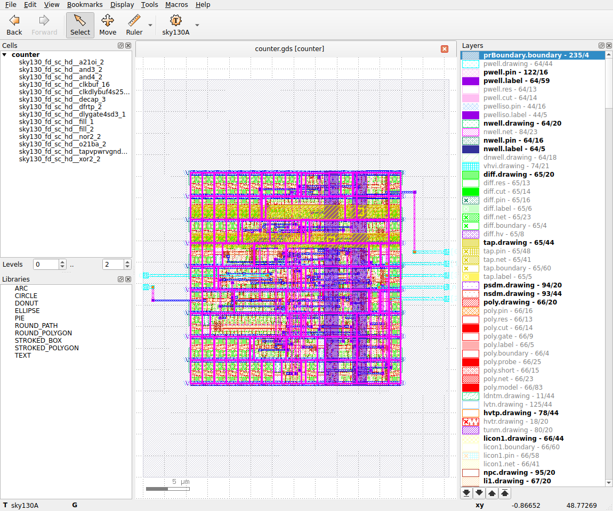

# DD103 — RTL on FPGAs & ASICs

Write SystemVerilog, turn it into both an FPGA bitstream and a chip layout, and learn why
those two results differ.

Part of the UofT ASIC Team education materials, published at https://uoftasic.com/dd103/.
The labs run in the workbench: the IIC-OSIC-TOOLS container desktop you start from the shared
`workspace` repo you set up in [IC101](https://uoftasic.com/ic101/).

## At a glance

| | |
|---|---|
| Who it's for | Students on the digital track who have finished DD102 and can write and simulate a small SystemVerilog module |
| Prerequisites | [IC101](https://uoftasic.com/ic101/), then [DD102](https://uoftasic.com/dd102/), in that order |
| Tools | Yosys, Verilator, Icarus, nextpnr, OpenSTA, LibreLane, KLayout, all inside the workbench |
| Time | 18 h 50 min to 19 h 50 min, self-paced: the sum of the Course path rows below |
| Machine | 4 GB RAM to run, 8 GB to be comfortable. You already have the workbench from IC101. |

The course is pinned to the workbench image `hpretl/iic-osic-tools:2026.08`, which ships
Yosys 0.68 and LibreLane 3.1.0.dev3. Documentation online describes newer versions, sometimes
with different option names. When a command here disagrees with the internet, use the command
here: it is the one that runs on your machine. Lab 01, Part 1 checks your versions.

If the environment setup in Lab 01, Part 1 gives you trouble, try `make` in the lab's package
directory anyway. Every lab package names its own technology files (the PDK and the cell
library), so Labs 01–04 run to completion even in a container with no environment setup. Lab 05
uses LibreLane and does need the full workbench.

## What you'll do

DD102 ended with a 4-bit ripple adder you wrote yourself. DD103 starts from that file. You'll:

1. Run one `ripple4.sv` through two synthesis flows and get two different pieces of hardware
2. See your RTL as a diagram, then see the same design as named standard cells from SKY130,
   SkyWater's 130 nm process
3. Read the `stat` report Yosys prints: cells, square micrometres, and what fraction is flip-flops
4. Measure how slow your adder is, in nanoseconds, and see why the carry chain sets that number
5. Design a 4-floor elevator controller from a state table
6. Take it all the way to a GDSII file, a chip layout that passes DRC (the shapes can be
   manufactured) and LVS (the layout matches your design)

*The four-bit counter from Lab 02, after LibreLane at `FP_CORE_UTIL: 30`. It is 35.5 µm by
46.3 µm with 98 cell instances, opened in KLayout with the SKY130 layer palette. The cell list
on the left is every standard cell it is made of.*

## Course path

Work down this table in order. A Read row is guide pages: concepts and worked examples, no
commands to run. A Do row is one lab, where you run everything.

| # | | What | Time |
|---|---|---|---|
| 1 | Read | [Getting started](guide/getting-started.md) | 20 min |
| 2 | Do | [Lab 01: One adder, two targets](labs/lab-01-one-adder-two-targets-overview.md). Run one ripple-carry adder through an FPGA flow and an ASIC flow, and write down what each one built. | 1.5 h |
| 3 | Read | [FPGA and ASIC targets](guide/warehouse-and-empty-lot.md) · [What synthesis does](guide/synthesis-is-translation.md) · [Standard cells](guide/standard-cells-are-real.md) | 1.5 h |
| 4 | Do | [Lab 02: RTL becomes gates](labs/lab-02-rtl-becomes-gates-overview.md). Draw a full adder before and after it becomes SKY130 cells, watch each synthesis pass change a counter, and open one cell in the library. | 2.5 h |
| 5 | Read | [Synthesizable SystemVerilog](guide/the-hardware-dialect.md) · [Inferred latches](guide/the-latch-you-didnt-ask-for.md) · [Blocking and non-blocking assignments](guide/blocking-vs-nonblocking.md) | 1.5 h |
| 6 | Do | [Lab 03: Three ways to lose a latch](labs/lab-03-three-ways-to-lose-a-latch-overview.md). Synthesize and lint one incomplete `case` under five headers, and count the flip-flops that `=` and `<=` build. | 2.5 h |
| 7 | Read | [Reading the `stat` report](guide/reading-stat.md) · [Carry delay and static timing](guide/the-carry-has-to-walk.md) | 1 h |
| 8 | Do | [Lab 04: Reading the receipt](labs/lab-04-reading-the-receipt-overview.md). Predict flip-flop counts, areas and delays before the tools report them, and work out why your predictions miss. | 3 h |
| 9 | Read | [Writing a state machine](guide/state-machine-is-a-table.md) · [From netlist to layout](guide/from-gates-to-geometry.md) | 1 h |
| 10 | Do | [Lab 05: Elevator to GDSII](labs/lab-05-elevator-overview.md). Finish an elevator controller from its state table and take it to a GDSII layout that passes DRC and LVS. | 4–5 h |

Keep these reference pages open while you work; you look things up in them rather than read
them through:

- [The synthesizable subset](reference/synthesizable-subset.md)
- [When Yosys says syntax error](reference/yosys-syntax-errors.md)
- [Looking things up in the SKY130 library](reference/sky130-library-lookups.md)
- [OpenLane, OpenLane 2, LibreLane](reference/the-name-history.md)
- [Troubleshooting](reference/troubleshooting.md): tool messages in the labs that aren't your
  design's fault

If you get stuck, ask in the [team Discord](https://discord.gg/hrJnP5UsGz). See
[Getting help](guide/getting-started.md#getting-help) for what to include in your question.

## At the end of the course

A `.gds` file containing a chip you designed, which passes the same physical checks a
commercial design would. You'll also be able to answer three questions about any RTL you
write: how big is it, how fast is it, and how do you know?

## Next courses

- [DD104](https://uoftasic.com/dd104/): Pre-Silicon Verification. Find the bugs hiding in a real 8-bit core.
- DD201: HLS · DD202: Computer Architecture
