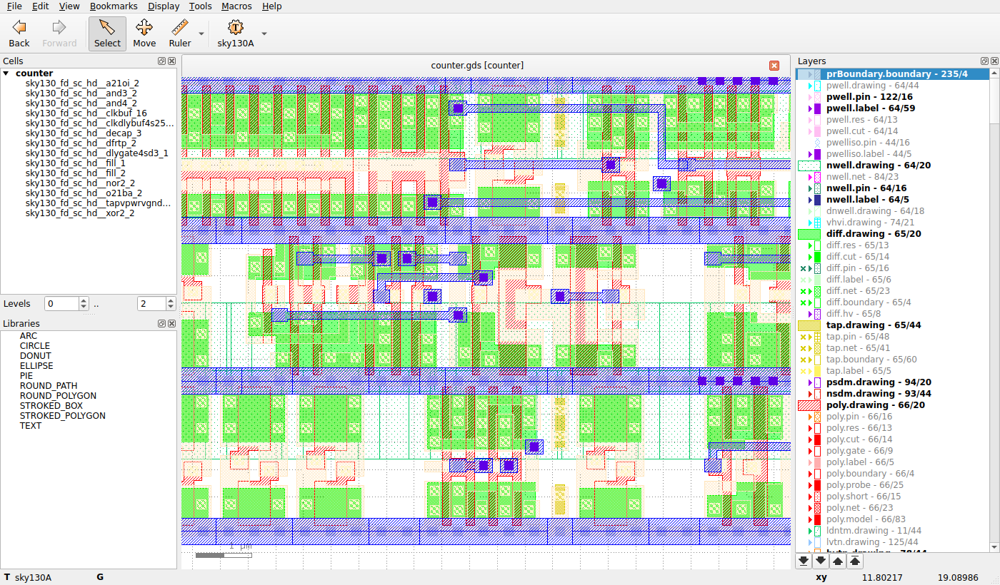
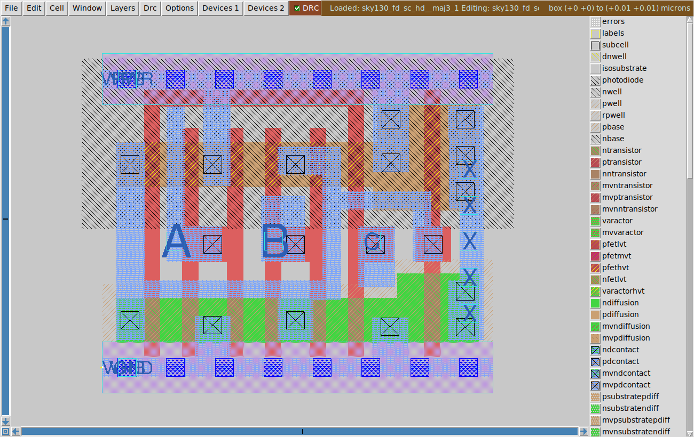

# Standard cells

This page explains what a standard cell is, using the SKY130 library files on your disk. You'll
open the same files yourself in
[Lab 02, Part 4](labs/lab-02-rtl-becomes-gates-overview.md#part-4-open-the-cell-library).

Since [Lab 01](labs/lab-01-one-adder-two-targets-overview.md) you have been pointing Yosys at
this path:

```
/foss/pdks/sky130A/libs.ref/sky130_fd_sc_hd/lib/sky130_fd_sc_hd__tt_025C_1v80.lib
```

Pointing at it makes `stat` print square micrometres instead of a bare cell count. It is easy to
assume it holds something abstract: a model, an estimate, a placeholder for real hardware. It is
a catalogue of physical objects, and you can count them.

## Video: from RTL to cells

This 3-minute video is silent and captioned; the captions are the narration. It takes the full
adder from [Lab 01](labs/lab-01-one-adder-two-targets-overview.md) from seven lines of
SystemVerilog to two cells out of this catalogue, and prices them.

<video controls loop muted playsinline preload="none"
       poster="assets/img/rtl-to-cells.poster.png"
       style="width:100%;max-width:820px;border-radius:8px">
  <source src="assets/img/rtl-to-cells.web.mp4" type="video/mp4">
</video>

In the last third, the animation chains four of those adders and asks for the total area. Write
your answer down before it shows you. The answer you write will be wrong, on purpose, and the
size of the gap is the most useful thing on this page.

## The size of the library

The liberty file is 13 MB and 173,157 lines long, and counting its `cell (` entries gives 428.
That is the whole vocabulary: exactly 428 cells. Every gate in every design that uses this
library is one of those 428.

Big chips also contain things that are not standard cells, and they live in sibling directories
under `/foss/pdks/sky130A/libs.ref/`: `sky130_sram_macros` (memory blocks), `sky130_fd_io` (the
pads that connect to the outside world), and `sky130_fd_pr` (raw transistors, for analog).
Everything you build in DD103 comes out of the one `.lib` file.

## What a design uses

The counter from [What synthesis does](guide/synthesis-is-translation.md) came back as these
cells:

```
        1    6.256   sky130_fd_sc_hd__a31oi_1
        4  100.096   sky130_fd_sc_hd__dfrtp_1
        1    6.256   sky130_fd_sc_hd__lpflow_isobufsrc_1
        1    3.754   sky130_fd_sc_hd__nand2_1
        1    6.256   sky130_fd_sc_hd__nand4_1
        2   17.517   sky130_fd_sc_hd__xnor2_1
        1    8.758   sky130_fd_sc_hd__xor2_1
```

That is seven distinct types out of 428. The `ripple4.sv` from Lab 01 used two, `maj3_1` and
`xnor2_1`. Synthesis is ordering from a menu, and the menu is short.

## One catalogue entry

You already met `sky130_fd_sc_hd__maj3_1`: it was four of the twelve cells in your ripple adder,
at 10.01 µm² each. Its entry in the liberty file is 350 lines long. These are the lines that
carry the meaning:

```
        area : 10.009600000;
        cell_footprint : "sky130_fd_sc_hd__maj3";
        pin ("A") {
            direction : "input";
        pin ("B") {
            direction : "input";
        pin ("C") {
            direction : "input";
        pin ("X") {
            direction : "output";
            function : "(A&B) | (A&C) | (B&C)";
```

Read the `function` line: `(A&B) | (A&C) | (B&C)`. X is high when at least two of the three
inputs are high. That is the majority function, which is exactly the carry-out of a full adder,
and it is why your adder came back with four of these.

The entry declares four things a synthesizer needs: what the cell computes, how big it is, what
its pins are called, and, in the other 344 lines, how long it takes.

## Area and the LEF rectangle

`area : 10.0096` looks like a modelled figure. It isn't. The same cell has a second entry in the
physical library, `sky130_fd_sc_hd.lef`, and that one is a rectangle:

```
MACRO sky130_fd_sc_hd__maj3_1
  CLASS CORE ;
  FOREIGN sky130_fd_sc_hd__maj3_1 ;
  ORIGIN 0.000 0.000 ;
  SIZE 3.680 BY 2.720 ;
  SYMMETRY X Y R90 ;
```

$$3.680 \times 2.720 = 10.0096$$

The liberty area is the width times the height of an actual rectangle of silicon, to four
decimal places, with nothing rounded, modelled or guessed. This cell is 3.68 µm across. A human
hair is around 70 µm, so nineteen of these would fit across one.

## Row height and width grid

Listing every cell's height in the LEF file gives:

```
    430 2.720
      7 5.440
```

430 of the 437 layouts are exactly 2.720 µm tall, and the other seven are exactly double. The
smallest widths are:

```
0.460
0.920
1.380
1.840
```

Every width is a multiple of 0.460 µm; `maj3_1` at 3.680 is eight of them.

That is the reason for the name. Cells are drawn to a fixed height and a quantised width so they
snap side by side into rows, like text on a page, with the power and ground rails lining up at
the top and bottom of every row. Placement then becomes a matter of arranging tiles rather than
drawing transistors. The alternative, where every gate is a different shape, is what people did
before 1980, by hand, with tape.

Here is part of a real chip built from this library: the counter from
[Lab 02](labs/lab-02-rtl-becomes-gates-overview.md), hardened by LibreLane and opened in KLayout.



The picture shows three rows, each 2.720 µm tall, each bounded top and bottom by the horizontal
`met1` rails that carry `VPWR` and `VGND`. The rails of one row are the rails of the next, which
is what the fixed height is for. The cells sit shoulder to shoulder with no gaps: where the
placer ran out of logic it dropped in filler, because a row with a hole in it is not a legal
shape.

This view has `met2` and everything above it turned off, along with the implant masks, so the
transistors underneath are visible. With them on, the routing covers the cells completely, which
is what your own KLayout window will show when you first open a `.gds`.

## Transistors and layout

The liberty entry is a description. Two directories over is the thing being described.

The transistor netlist, `cdl/sky130_fd_sc_hd.cdl`, starts the `maj3_1` subcircuit like this:

```
.SUBCKT sky130_fd_sc_hd__maj3_1 A B C VGND VNB VPB VPWR X
*.PININFO A:I B:I C:I VGND:I VNB:I VPB:I VPWR:I X:O
MMIN2 X y VGND VNB nfet_01v8 m=1 w=0.65 l=0.15 mult=1 sa=0.265
+ sb=0.265 sd=0.28 topography=normal area=0.063 perim=1.14
MMN10 y B sndNBa VNB nfet_01v8 m=1 w=0.42 l=0.15 mult=1 sa=0.265
+ sb=0.265 sd=0.28 topography=normal area=0.063 perim=1.14
```

Counting the `MM` lines gives fourteen transistors, seven n-type and seven p-type, each with a
channel width (`w=0.65`, `w=0.42`) that somebody chose.

The layout, `mag/sky130_fd_sc_hd__maj3_1.mag`, is a 7.4 KB file with 267 rectangles describing a
shape 3.68 µm by 2.72 µm. It lists sixteen sections:

```
 nwell   pwell   scnmos   scpmoshvt   ndiff   pdiff   ndiffc   pdiffc   poly   polycont   locali   viali   metal1   labels   properties   end
```

Thirteen of them are real mask layers, such as `nwell`, `poly` and `metal1`; `labels`,
`properties` and `end` are bookkeeping. Opened in Magic, the cell looks like this:



Those are the 267 rectangles, drawn. The vertical stripes crossing the diffusion are the
fourteen transistor gates the `.cdl` listed. `A`, `B`, `C` and `X` are the four pins the liberty
entry named. The two wide bands at the top and bottom are the power rails that let this cell
abut its neighbours. The palette on the right is every layer the technology has.

So a standard cell is a specific arrangement of 267 polygons that a person laid out, that a real
foundry knows how to print, and that has been printed on real wafers. When `stat` charges you
10.01 µm², this is what it is charging you for.

## Timing tables

The other 344 lines of the liberty entry are measurements, in 24 tables. Here is the start of
one:

```
                cell_rise ("del_1_7_7") {
                    index_1("0.0100000000, 0.0230506000, 0.0531329000, 0.1224740000, …");
                    index_2("0.0005000000, 0.0013016700, 0.0033886700, 0.0088218400, …");
                    values("0.1064958000, 0.1147213000, 0.1330062000, 0.1734156000, …", \
                        …
```

`index_1` is how fast the input edge arrives. `index_2` is how much capacitance hangs off the
output. `values` is the resulting delay in nanoseconds, for all 49 combinations. Delay depends on
what is driving the cell and what it is driving, so the library ships a 7 × 7 grid and the timing
tools interpolate.

Twenty-four tables of forty-nine numbers each is 1,176 measured numbers for one three-input gate.
The whole library has 11,101 tables. That is where the 13 MB went, and it is why building a
standard-cell library takes years: every point in every grid came from a circuit simulation, run
against transistor models the foundry calibrated against real silicon.

## Drive strengths

`maj3_1` has siblings:

| Cell | Liberty area | Layout |
|---|---|---|
| `sky130_fd_sc_hd__maj3_1` | 10.0096 µm² | 3.680 × 2.720 |
| `sky130_fd_sc_hd__maj3_2` | 11.2608 µm² | 4.140 × 2.720 |
| `sky130_fd_sc_hd__maj3_4` | 13.7632 µm² | 5.060 × 2.720 |

They have the same function, the same three inputs and the same `cell_footprint`. The suffix is
the drive strength. The transistor channel widths show what changes:

```
maj3_1:      12 w=0.42       1 w=0.65       1 w=1.0
maj3_2:       6 w=0.42       6 w=0.64       1 w=0.65       1 w=1.0
maj3_4:       7 w=0.65       7 w=1.0
```

It is the same fourteen transistors every time, just wider. A wider channel passes more current,
so it charges whatever the output drives faster, and it needs more room: `maj3_4` costs 37 % more
area than `maj3_1` and computes exactly the same function.

That is why there are 428 cells but only 143 distinct `cell_footprint` values: 143 things the
library can compute, and 428 ways to buy them. Picking drive strengths is not your job. `abc` and
the placer make that choice, and it is most of what "timing optimization" means in practice.

## The full-adder cell

The catalogue has a cell called `sky130_fd_sc_hd__fa_1`:

```
        area : 20.019200000;
            function : "(A&B) | (A&CIN) | (B&CIN)";
            function : "(A&!B&!CIN) | (!A&B&!CIN) | (!A&!B&CIN) | (A&B&CIN)";
```

It has two outputs, `COUT` and `SUM`: a complete one-bit full adder in a single cell, the module
you wrote in DD102, at 20.02 µm².

Your `fulladder.sv` did not synthesize to it. It came back as `maj3_1` plus `xor3_1`:

```
        2   33.782 cells
        1    10.01   sky130_fd_sc_hd__maj3_1
        1   23.773   sky130_fd_sc_hd__xor3_1
```

That is 33.78 µm², with a 20.02 µm² cell sitting unused in the same file. ABC mentions it while
reading the library:

```
ABC: Warning: Detected 9 multi-output cells (for example, "sky130_fd_sc_hd__fa_1").
```

ABC's mapper covers a netlist with single-output gates, and it reports that it found nine cells
that are not that shape. It then mapped your full adder without using one.

This doesn't mean Yosys is bad. It means the library and the tool are separate things, and the
tool decides which part of the library you can reach. Commercial mappers handle multi-output
cells, and a different open flow might too. The catalogue is fixed; what you can order from it
depends on who takes the order.

## Process corners

The file you have been using is one of 18 `.lib` files in
`/foss/pdks/sky130A/libs.ref/sky130_fd_sc_hd/lib/`, 329 MB in all, with the same 428 cells in
every one. What changes is the conditions the timing was characterised under, and the filename
says which:

`sky130_fd_sc_hd__` `tt` `_` `025C` `_` `1v80` `.lib`

- `tt` is typical-typical: transistors came out of the fab at nominal speed. The neighbours are
  `ff` (fast) and `ss` (slow).
- `025C` means it was characterised at 25 °C. Others go to −40 °C and 100 °C.
- `1v80` is a 1.80 V supply. Others run from 1.28 V to 1.95 V.

The liberty file agrees with its own name:

```
    nom_process : 1.0000000000;
    nom_temperature : 25.000000000;
    nom_voltage : 1.8000000000;
```

A chip has to work across all of them. DD103 uses `tt_025C_1v80` throughout because it is the
middle of the range and one corner is enough to learn on. A real design closes timing against
several of these files at once, and the `ss` ones (slow transistors, low voltage) are where setup
timing usually fails.

## Reading a cell name

The prefix carries information too:

| Piece | Means |
|---|---|
| `sky130` | SkyWater's 130 nm process |
| `fd` | foundry: SkyWater drew these themselves |
| `sc` | standard cell |
| `hd` | high density, the 2.720 µm row height. The same PDK also ships `sky130_fd_sc_hvl`, a high-voltage family on a 4.070 µm row |
| `__maj3` | the function |
| `_1` | drive strength |

So `sky130_fd_sc_hd__maj3_1` reads as "SkyWater's own 130 nm high-density standard-cell
three-input majority gate, weakest drive".

## Smallest and largest cells

Sorting the catalogue by area gives these three at each end:

```
2.5024000000;     cell ("sky130_fd_sc_hd__diode_2") {
3.7536000000;     cell ("sky130_fd_sc_hd__buf_1") {
3.7536000000;     cell ("sky130_fd_sc_hd__clkbuf_1") {
41.289600000;     cell ("sky130_fd_sc_hd__sdfbbn_2") {
41.289600000;     cell ("sky130_fd_sc_hd__sedfxbp_2") {
45.043200000;     cell ("sky130_fd_sc_hd__lpflow_isobufsrc_16") {
```

The whole catalogue spans 2.50 µm² to 45.04 µm², a factor of 18. No cell is a hundred times
bigger than another, because they all have to fit the same row. So a design's area grows by
using more cells, not dramatically bigger ones. That is why "how many cells?" and "how many
µm²?" get asked together, and why a cell count alone already tells you roughly what you are
dealing with.

Two of the three largest entries are flip-flops, `sdfbbn_2` and `sedfxbp_2`, both 41.29 µm²,
while `nand2_1` is 3.75 µm². Even the plain reset flop your counter used, `dfrtp_1`, is
25.02 µm², about seven NAND gates' worth.

A bit of memory costs several times what a bit of logic costs. That ratio is why your counter,
with four flip-flops and seven gates, spent 67.23 % of its area on remembering and only the rest
on computing.

## Summary

- 428 cells, 13 MB, 173,157 lines: a fixed menu you can count.
- A cell entry declares a Boolean function, an area, pins, and 24 tables of measured timing.
- The area is a real rectangle: `maj3_1` is 3.680 × 2.720 = 10.0096 µm², drawn as 267 polygons
  on 13 layers by a person.
- Every cell is 2.720 µm tall and a multiple of 0.460 µm wide. That is what makes them standard.
- `_1` / `_2` / `_4` is drive strength: 143 functions, 428 variants.
- A flip-flop costs several plain gates: `dfrtp_1` is 25.02 µm² and `nand2_1` is 3.75 µm².

Next: [Lab 02: RTL becomes gates](labs/lab-02-rtl-becomes-gates-overview.md). Later in the
course, [Reading the `stat` report](guide/reading-stat.md) turns that last point into a number
you'll quote in every design review.
