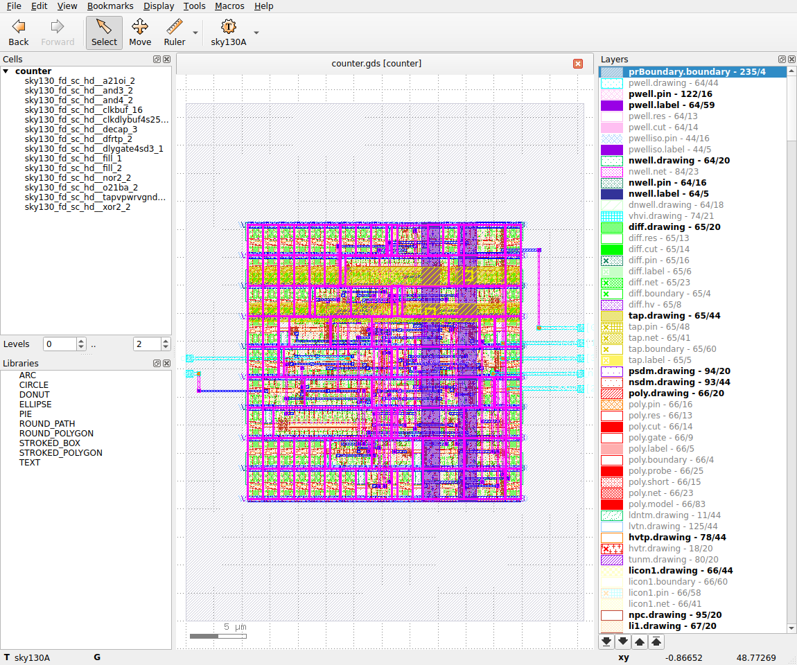

# DD103 — RTL on FPGAs & ASICs

In this course you turn SystemVerilog into an FPGA bitstream and into a chip layout. The first lab's
package includes the 4-bit adder from DD102. You run it through an FPGA flow and an ASIC flow and
compare what each one builds. Over the next three labs you see a full adder before and after Yosys
maps it to SKY130 cells, find out when an incomplete `case` becomes a latch, and predict area and
delay before Yosys and OpenSTA report them. The last lab has you finish a four-floor elevator
controller from its state table and take it to a GDSII layout that passes DRC and LVS.

DD103 is part of the UofT ASIC Team education materials, published at
https://uoftasic.com/dd103/. The labs run in the workbench, which is the IIC-OSIC-TOOLS container
desktop that you start from the shared `workspace` repo you set up in
[IC101](https://uoftasic.com/ic101/).

## At a glance

| | |
|---|---|
| Who it's for | Students on the digital track who have finished DD102 and can write and simulate a small SystemVerilog module |
| Prerequisites | [IC101](https://uoftasic.com/ic101/), then [DD102](https://uoftasic.com/dd102/), in that order |
| Tools | Yosys, Verilator, Icarus, nextpnr, OpenSTA, LibreLane, KLayout, all inside the workbench |
| Time | 18 h 50 min to 19 h 50 min, self-paced. That's the sum of the Course path rows below. |
| Machine | 4 GB of RAM is enough to run the labs, and 8 GB is comfortable. You already have the workbench from IC101. |

The course is pinned to the workbench image `hpretl/iic-osic-tools:2026.08`, which ships
Yosys 0.68 and LibreLane 3.1.0.dev3. Documentation online describes newer versions, sometimes
with different option names. When a command here disagrees with what you find on the internet,
use the one here, because it's the one that runs on your machine. You'll check your versions in
Lab 01, Part 1.

If the environment setup in Lab 01, Part 1 gives you trouble, try `make` in the lab's package
directory anyway. Every lab package names its own technology files (the PDK and the cell
library), so Labs 01–04 run to completion even in a container with no environment setup. Lab 05
uses LibreLane, though, and does need the full workbench.

## What you'll do

DD102 ended with a 4-bit ripple adder that you wrote yourself, and DD103 starts from that same
adder. Over the course you'll:

1. Run one `ripple4.sv` through two synthesis flows and get two different pieces of hardware
2. See your RTL as a diagram, then see the same design as named standard cells from SKY130,
   SkyWater's 130 nm process
3. Read the `stat` report that Yosys prints, which gives the number of cells, the area in square
   micrometres, and how much of that area is flip-flops
4. Measure how slow your adder is, in nanoseconds, and see why the carry chain sets that number
5. Design a 4-floor elevator controller from a state table
6. Take it all the way to a GDSII file, a chip layout that passes DRC (the shapes can be
   manufactured) and LVS (the layout matches your design)

*The four-bit counter you'll synthesize in Lab 02, taken through LibreLane at `FP_CORE_UTIL: 30`
(Lab 05 explains the setting). It is 35.5 µm by 46.3 µm with 98 cell instances, opened in KLayout
with the SKY130 layer palette. The cell list on the left names every standard cell it's made of.*

## Course path

Work down this table in order. A Read row is a set of guide pages, with concepts and worked
examples and no commands to run. A Do row is one lab, and the labs are where you run everything.

| # | | What | Time |
|---|---|---|---|
| 1 | Read | [Getting started](guide/getting-started.md) | 20 min |
| 2 | Do | [Lab 01: One adder, two targets](labs/lab-01-one-adder-two-targets-overview.md). Run one ripple-carry adder through an FPGA flow and an ASIC flow, and write down what each one built. | 1.5 h |
| 3 | Read | [FPGA and ASIC targets](guide/warehouse-and-empty-lot.md) · [What synthesis does](guide/synthesis-is-translation.md) · [Standard cells](guide/standard-cells-are-real.md) | 1.5 h |
| 4 | Do | [Lab 02: RTL becomes gates](labs/lab-02-rtl-becomes-gates-overview.md). Draw a full adder before and after it becomes SKY130 cells, watch each synthesis pass change a counter, and open one cell in the library. | 2.5 h |
| 5 | Read | [Synthesizable SystemVerilog](guide/the-hardware-dialect.md) · [Inferred latches](guide/the-latch-you-didnt-ask-for.md) · [Blocking and non-blocking assignments](guide/blocking-vs-nonblocking.md) | 1.5 h |
| 6 | Do | [Lab 03: Three ways to lose a latch](labs/lab-03-three-ways-to-lose-a-latch-overview.md). Synthesize and lint one incomplete `case` written five ways, and count the flip-flops that `=` and `<=` build. | 2.5 h |
| 7 | Read | [Reading the `stat` report](guide/reading-stat.md) · [Carry delay and static timing](guide/the-carry-has-to-walk.md) | 1 h |
| 8 | Do | [Lab 04: Reading the receipt](labs/lab-04-reading-the-receipt-overview.md). Predict flip-flop counts, areas and delays before the tools report them, and work out why your predictions miss. | 3 h |
| 9 | Read | [Writing a state machine](guide/state-machine-is-a-table.md) · [From netlist to layout](guide/from-gates-to-geometry.md) | 1 h |
| 10 | Do | [Lab 05: Elevator to GDSII](labs/lab-05-elevator-overview.md). Finish an elevator controller from its state table and take it to a GDSII layout that passes DRC and LVS. | 4–5 h |

These reference pages are for looking things up rather than reading through, so keep them open
while you work:

- [The synthesizable subset](reference/synthesizable-subset.md)
- [When Yosys says syntax error](reference/yosys-syntax-errors.md)
- [Looking things up in the SKY130 library](reference/sky130-library-lookups.md)
- [OpenLane, OpenLane 2, LibreLane](reference/the-name-history.md)
- [Troubleshooting](reference/troubleshooting.md), for tool messages you'll meet in the labs
  that aren't caused by your design

If you get stuck, ask in the [team Discord](https://discord.gg/hrJnP5UsGz). See
[Getting help](guide/getting-started.md#getting-help) for what to include in your question.

## At the end of the course

You'll have a `.gds` file containing a chip you designed, and it passes the same physical checks
a commercial design would. You'll also be able to answer three questions about any RTL you
write: how big is it, how fast is it, and how do you know?

## Next courses

- [DD104](https://uoftasic.com/dd104/): Pre-Silicon Verification, where you write tests that catch thirteen broken versions of an 8-bit processor.
- DD201: HLS · DD202: Computer Architecture
