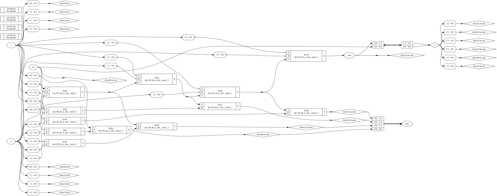

# Lab 02 — RTL becomes gates

Full runnable package: [`labs/lab-02-rtl-becomes-gates/`](https://github.com/uoftasic/dd103/tree/main/labs/lab-02-rtl-becomes-gates).

Lab 01 told you your adder became `4 × maj3_1 + 8 × xnor2_1`. You had to take that
on faith, because a list of cell names is not a circuit — you cannot see what is
wired to what.

This lab draws the picture. Twice: once in your words, once in the foundry's.

## Prerequisites

- [Lab 01](labs/lab-01-one-adder-two-targets-overview.md) complete — you have run `abc -liberty` at least once
- `yosys -V` says **`Yosys 0.68`**
- Read [Synthesis is translation with an accent](guide/synthesis-is-translation.md)
  and [A standard cell is a real thing](guide/standard-cells-are-real.md)
- A way to look at an SVG: the noVNC desktop's file manager, or `firefox results/*.svg &`

## Objectives

- Produce two diagrams of one module from a single Yosys session
- Point at a wire in the second diagram and say which line of your SystemVerilog it came from
- Say what `dfflibmap` and `abc` each did, in one sentence apiece
- Know, before you need it, exactly how large a design you can usefully draw

## Theory (short)

Yosys keeps one design in memory and rewrites it in place. `show` photographs
whatever is in memory *right now*. Run it twice at two different moments and you
get two views of the same thing.

The moments that matter:

| After this | The design is made of | Whose names are on it |
|---|---|---|
| `proc; opt` | `$xor`, `$and`, `$or`, `$add`, `$mux` | **yours** |
| `abc -liberty` | `sky130_fd_sc_hd__*` | the foundry's |

Between them sit two mapping passes that split the work by kind:

- **`dfflibmap -liberty LIB`** replaces generic flip-flops with library flops. Your
  full adder has none, so this does nothing here. It is in the script because
  leaving it out of a design that *does* have flops produces a broken area number,
  which is [Lab 04](labs/lab-04-reading-the-receipt-overview.md)'s second experiment.
- **`abc -liberty LIB`** takes everything combinational and finds a covering of it
  using cells from the liberty file, optimizing for area.

Those two passes are why the picture changes. Nothing else in the script touches
what the design *means*.

## Procedure

```bash
. /foss/designs/common/.designinit
mod dd103
cd labs/lab-02-rtl-becomes-gates
make
```

Under two seconds, start to finish. Then open both SVGs side by side.

### Step 1 — Your circuit, in your words

- **Try this:** `make`, then open `results/rtl.svg`.
- **What you should see:** five boxes, and every wire label is something you typed.

  

  The octagons `a`, `b`, `cin`, `sum`, `cout` are your ports. The boxes are
  `$2 $xor`, `$3 $and`, `$4 $xor`, `$5 $and`, `$6 $or` — one for each operator in
  these two lines:

  ```systemverilog
  assign sum  = a ^ b ^ cin;
  assign cout = (a & b) | (cin & (a ^ b));
  ```

  Count them: two `^` in the first line, one `&`, one `|`, one `&`, one `^` in the
  second. That is six operators and there are five boxes, because `opt` noticed
  that `a ^ b` appears in both lines and computed it once. Follow the fan-out from
  `$4 $xor` — one output, two destinations. That black dot is the sharing.

- **Why an engineer cares:** this is the last picture in the flow that is still
  *about your source code*. Every diagram after this one is about the technology.
  If your RTL is wrong, this is where you can still see it.

### Step 2 — The same circuit, in SKY130's words

- **Try this:** open `results/gates.svg` next to the first one.
- **What you should see:** two boxes.

  

  ```
  $95   sky130_fd_sc_hd__maj3_1     A B C -> X
  $94   sky130_fd_sc_hd__xor3_1     A B C -> X
  ```

  Same five ports. Same names on the octagons — `a`, `b`, `cin`, `sum`, `cout` are
  still yours, because they are the module boundary and nothing is allowed to
  rename them. Everything *between* them is gone, replaced by two cells whose names
  you did not choose and whose pins are called `A`, `B`, `C`, and `X`.

  And `stat` prices them:

  ```
  === fulladder ===
          2   33.782 cells
          1    10.01   sky130_fd_sc_hd__maj3_1
          1   23.773   sky130_fd_sc_hd__xor3_1
     Chip area for module '\fulladder': 33.782400
  ```

- **Why an engineer cares:** **this pair of images is the entire point of DD103.**
  Five operators you wrote became two rectangles that a foundry will etch. The left
  picture is a description of behaviour. The right picture is a bill of materials.
  Synthesis is the thing that turns one into the other, and you just watched it
  happen in one second on your own laptop.

### Step 3 — Where the two `^` went

- **Try this:** stare at the two diagrams until the arithmetic bothers you. Five
  boxes became two. Which box became which?
- **What you should see:** nothing lines up. There is no box-for-box mapping.
  Instead:
  - `sum = a ^ b ^ cin` — a three-input XOR — became **one** `xor3_1`. SKY130 ships
    a 3-input XOR as a single cell, so the two `$xor` boxes collapsed into it.
  - `cout = (a & b) | (cin & (a ^ b))` — three boxes — became **one** `maj3_1`,
    because carry-out *is* the majority function: it is true exactly when at least
    two of $a$, $b$, $c_{\text{in}}$ are true. ABC proved that from the truth table
    and found a cell that does it in fourteen transistors.
- **Why an engineer cares:** synthesis is not translation, gate by gate. It reads
  what your logic *computes*, throws away how you wrote it, and re-derives it from
  the catalogue. Rewriting `cout` as `(a & b) | (b & cin) | (a & cin)` gives you the
  identical netlist. Try it.

  It also means the reverse: you cannot read a gate netlist and recover the RTL.
  The structure you wrote is gone.

### Step 4 — Watch it stop working

Diagrams have a size limit, and you should meet it here rather than at 2 a.m.
during the capstone.

- **Try this:**

  ```bash
  make bigger
  ```

  This runs the same two `show` calls on `ripple4` — four full adders instead of
  one — and then prints the canvas size of every SVG in `results/`.

- **What you should see:**

  ```
  ==============================================================
   DIAGRAM CANVAS SIZES  (graphviz points; 72 pt = 1 inch)
  ==============================================================
  results/gates.svg                  width="453pt" height="171pt"
  results/gates_ripple4.svg          width="3189pt" height="1264pt"
  results/rtl.svg                    width="666pt" height="172pt"
  results/rtl_ripple4.svg            width="1265pt" height="648pt"
  ```

  Open `results/rtl_ripple4.svg`: four boxes labelled `slice[0].fa` … `slice[3].fa`,
  chained through `c`. It is the picture of a ripple adder you would have drawn on
  paper.

  

  Now open `results/gates_ripple4.svg`. It is **44 inches wide**: twelve cells,
  a scatter of bit-slice splitters, and no visual centre. Squashed to the width of
  this page it looks like this, and blowing it up does not help —

  

  Nothing is wrong with it. It is simply not a diagram any more.

- **Why an engineer cares:** the gate view grew **52× in canvas area** going from
  one adder to four. That is the scaling you are up against, and it is not a
  gentle curve.

> **The rule for the rest of this course: gate view of one small block, RTL view of
> anything bigger.** The elevator FSM in [Lab 05](labs/lab-05-elevator-overview.md) is 76 cells,
> and its gate view comes out 883 × 9018 pt — do not try to draw it. Draw its RTL, or
> pick one sub-module.
> This is not a limitation you will grow out of — it is why professional flows show
> you *numbers* and *layouts* rather than gate schematics.

## Expected results

| Check | Expected |
|---|---|
| `ls results/*.svg` | `gates.svg` and `rtl.svg` exist |
| `grep -o 'sky130[a-z0-9_]*' results/gates.svg \| sort -u` | `sky130_fd_sc_hd__maj3_1`, `sky130_fd_sc_hd__xor3_1` |
| `grep -c '\$xor' results/rtl.dot` | 2 |
| `grep "Chip area" results/show.log` | `33.782400` |
| `make sizes` after `make bigger` | four SVGs, the largest 3189 pt wide |

Total runtime for `make`: **about 1 second**, ~64 MB peak — Yosys prints its own `time:` and `MEM:` on the last line of `results/show.log`. If Yosys is taking minutes, you
are synthesizing something other than a full adder.

## Two traps

**`show -format svg` will only draw one module.** Both scripts end their `show`
line with an explicit module name. Drop it and you get:

```
ERROR: For formats different than 'ps' or 'dot' only one module must be selected.
```

which is confusing, because the script that produced it looks like it selected
nothing at all.

**Do not use `sak-v2svg.sh`.** It sits on your `PATH` in this image, its help text
is professionally written, and it will look like the official way to do this. It
is not usable here:

```
$ sak-v2svg.sh results/fulladder_sky130.v out.svg
[ERROR] Netlistsvg could not be found!
```

It wraps `netlistsvg`, which is not installed in the workbench and cannot be
installed — `npm` is absent from the image. Do not spend an evening on it. `show`
is built into Yosys, it is what this lab uses, and it works.

## Going further

Both scripts open with a line you might have skipped:

```tcl
read_liberty -lib /foss/pdks/sky130A/libs.ref/sky130_fd_sc_hd/lib/sky130_fd_sc_hd__tt_025C_1v80.lib
```

`-lib` reads the library as a **catalogue only** — cell names, pin names, pin
directions, no logic. Delete that line and re-run. The netlist is identical and
the area is identical, but the picture gets worse: `show` no longer knows which
pins are outputs, so it stacks `A B C X` down the left-hand side of every cell and
draws the arrows on `sum` and `cout` pointing backwards into the box.

The diagram was never the design. It is a rendering, and renderings have settings.

If you want a raster for a slide deck, `make png` runs `cairosvg` (2.9.0, in the
image) at 1200 px wide. Prefer the SVG for anything you will zoom into.

## Links

- [Lab package](https://github.com/uoftasic/dd103/tree/main/labs/lab-02-rtl-becomes-gates)
- Read next: [Reading `stat` like a receipt](guide/reading-stat.md) — you have seen two
  cells; now learn to read a hundred of them without opening a picture
- Next lab: [Lab 03 — Three ways to lose a latch](labs/lab-03-three-ways-to-lose-a-latch-overview.md),
  where the tool builds something you did not ask for and does not always tell you
