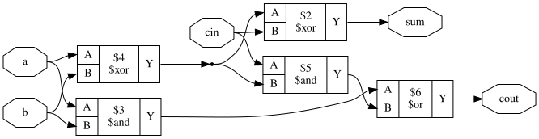
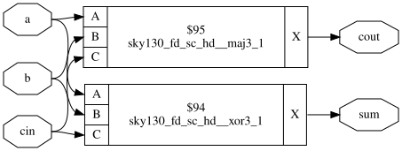
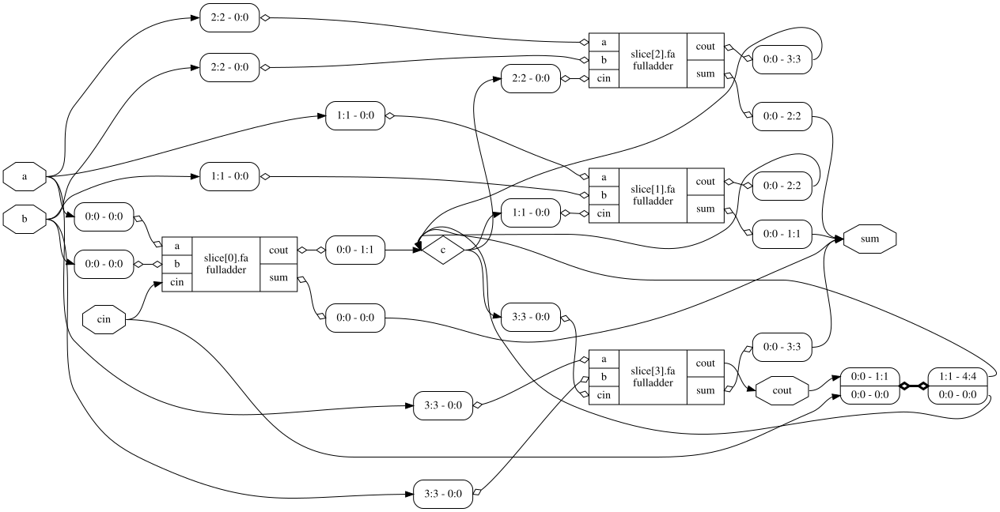

# Lab 02: RTL becomes gates

Lab 01 told you your adder became `4 × maj3_1 + 8 × xnor2_1`, but a list of cell names doesn't
show what is wired to what. In this lab you draw one full adder twice, once in your words and
once in SKY130's, then watch `synth` work on a counter pass by pass and open the cell library
those names come from.

Time: about 2.5 hours.

Package: [`labs/lab-02-rtl-becomes-gates/`](https://github.com/uoftasic/dd103/tree/main/labs/lab-02-rtl-becomes-gates)

## Before you start

- [Lab 01](labs/lab-01-one-adder-two-targets-overview.md) is complete, so you have run
  `abc -liberty` at least once and `yosys -V` says `Yosys 0.68`.
- Read [FPGA and ASIC targets](guide/warehouse-and-empty-lot.md),
  [What synthesis does](guide/synthesis-is-translation.md) and
  [Standard cells](guide/standard-cells-are-real.md).
- You need a way to look at an SVG: the noVNC desktop's file manager, or
  `firefox results/*.svg &`.

Start every part from the package directory, in a terminal where you have sourced
`.designinit`:

```bash
mod dd103
cd labs/lab-02-rtl-becomes-gates
```

## Part 1: Two pictures of a full adder

Yosys keeps one design in memory and rewrites it in place. `show` draws whatever is in memory at
that moment, so running it at two different points gives two views of the same design:

| After this | The design is made of | Whose names are on it |
|---|---|---|
| `proc; opt` | `$xor`, `$and`, `$or`, `$add`, `$mux` | yours |
| `abc -liberty` | `sky130_fd_sc_hd__*` | the foundry's |

Between those two points, `dfflibmap -liberty` replaces generic flip-flops with library flops.
The full adder has none, so it does nothing here; it is in the script because leaving it out of
a design that does have flops gives a broken area number, as you'll see in Part 3. Then
`abc -liberty` covers everything combinational with cells from the liberty file, optimizing for
area.

1. Run the script. It takes under two seconds.

   ```bash
   make
   ```

2. Open `results/rtl.svg`. You should see five boxes, and every wire label is something you
   typed.

   

   The octagons `a`, `b`, `cin`, `sum` and `cout` are your ports. The boxes are `$2 $xor`,
   `$3 $and`, `$4 $xor`, `$5 $and` and `$6 $or`, one for each operator in these two lines:

   ```systemverilog
   assign sum  = a ^ b ^ cin;
   assign cout = (a & b) | (cin & (a ^ b));
   ```

   The source has six operators: two `^` in the first line, and one `&`, one `|`, one `&` and
   one `^` in the second. There are five boxes because `opt` noticed that `a ^ b` appears in
   both lines and computed it once. Follow the fan-out from `$4 $xor`: one output, two
   destinations. The black dot is the sharing.

   This is the last picture in the flow that is still about your source code. If your RTL is
   wrong, this is where you can still see it.

3. Open `results/gates.svg` next to it. You should see two boxes.

   

   ```
   $95   sky130_fd_sc_hd__maj3_1     A B C -> X
   $94   sky130_fd_sc_hd__xor3_1     A B C -> X
   ```

   The five ports and their names are the same, because they are the module boundary and nothing
   is allowed to rename them. Everything between them is replaced by two cells whose names you
   did not choose and whose pins are called `A`, `B`, `C` and `X`. `stat` prices them, in
   `results/show.log`:

   ```
   === fulladder ===
           2   33.782 cells
           1    10.01   sky130_fd_sc_hd__maj3_1
           1   23.773   sky130_fd_sc_hd__xor3_1
      Chip area for module '\fulladder': 33.782400
   ```

   The left picture describes behaviour; the right picture is a bill of materials for
   something a foundry will etch. Synthesis turns one into the other.

4. Work out which boxes became which cell. There is no box-for-box mapping:

   - `sum = a ^ b ^ cin`, a three-input XOR, became one `xor3_1`. SKY130 has a 3-input XOR
     cell, so the two `$xor` boxes collapsed into it.
   - `cout = (a & b) | (cin & (a ^ b))`, three boxes, became one `maj3_1`, because carry-out is
     the majority function: true exactly when at least two of $a$, $b$, $c_{\text{in}}$ are
     true. ABC worked that out from the truth table and found a single cell for it.

   Synthesis works from what your logic computes, not from how you wrote it. Rewriting `cout`
   as `(a & b) | (b & cin) | (a & cin)` gives the identical netlist; try it. The reverse also
   holds: you can't read a gate netlist and recover the RTL you wrote.

You should see `results/rtl.svg` with five operator boxes and `results/gates.svg` with
`sky130_fd_sc_hd__maj3_1` and `sky130_fd_sc_hd__xor3_1`, and `Chip area ... 33.782400` in
`results/show.log`.

If `show` fails with this error:

```
ERROR: For formats different than 'ps' or 'dot' only one module must be selected.
```

the `show` line is missing its module name. `show -format svg` draws exactly one module, so both
scripts end their `show` line with one. The error is confusing because the line that produced it
looks like it selected nothing at all.

Do not use `sak-v2svg.sh`. It is on your `PATH`, its help text looks official, and it does not
work in this image:

```
$ sak-v2svg.sh results/fulladder_sky130.v out.svg
[ERROR] Netlistsvg could not be found!
```

It wraps `netlistsvg`, which is not installed in the workbench and can't be, because `npm` is
not in the image. `show` is built into Yosys and is what this lab uses.

## Part 2: Diagram size limits

Diagrams have a size limit, and it is better to meet it here than during the capstone.

1. Run the same two `show` calls on `ripple4`, four full adders instead of one:

   ```bash
   make bigger
   ```

   It prints the canvas size of every SVG in `results/`:

   ```
   ==============================================================
    DIAGRAM CANVAS SIZES  (graphviz points; 72 pt = 1 inch)
   ==============================================================
   results/gates.svg                  width="453pt" height="171pt"
   results/gates_ripple4.svg          width="3189pt" height="1264pt"
   results/rtl.svg                    width="666pt" height="172pt"
   results/rtl_ripple4.svg            width="1265pt" height="648pt"
   ```

2. Open `results/rtl_ripple4.svg`. It shows four boxes labelled `slice[0].fa` to
   `slice[3].fa`, chained through `c`: the ripple adder you would draw on paper.

   

3. Open `results/gates_ripple4.svg`. It is 44 inches wide: twelve cells, a scatter of bit-slice
   splitters, and no visual centre. Squashed to the width of this page it looks like this, and
   zooming in does not help:

   

You should see that the gate view grew 52× in canvas area going from one adder to four, while
the RTL view stayed readable.

For the rest of the course, draw the gate view of one small block only, and the RTL view of
anything bigger. The elevator FSM in [Lab 05](labs/lab-05-elevator-overview.md) is 76 cells, and
its gate view comes out 883 × 9018 pt, so you'll draw its RTL instead. This limit does not go
away with experience; it is why professional flows show you numbers and layouts rather than
gate schematics.

## Part 3: Watch synth work on a counter

This part runs the walkthrough from [What synthesis does](guide/synthesis-is-translation.md) on
`src/counter.sv`. Set the liberty path first; every command below uses it.

```bash
LIB=/foss/pdks/sky130A/libs.ref/sky130_fd_sc_hd/lib/sky130_fd_sc_hd__tt_025C_1v80.lib
```

1. Run the full ASIC flow on the counter and count the lines it prints:

   ```bash
   yosys -p "read_verilog -sv src/counter.sv; synth -top counter;
             dfflibmap -liberty $LIB; abc -liberty $LIB; opt_clean;
             stat -liberty $LIB" 2>&1 | wc -l
   ```

2. Run it again, keeping only the numbered top-level steps:

   ```bash
   yosys -p "read_verilog -sv src/counter.sv; synth -top counter;
             dfflibmap -liberty $LIB; abc -liberty $LIB; opt_clean;
             stat -liberty $LIB" 2>&1 | grep -E '^[0-9]+\. '
   ```

   You should see six lines, from `1. Executing Verilog-2005 frontend: src/counter.sv` to
   `6. Printing statistics.`

3. List the sub-passes that `synth` ran:

   ```bash
   yosys -p "read_verilog -sv src/counter.sv; synth -top counter" 2>&1 | grep -E '^2\.[0-9]+\. '
   ```

   You should see 26 lines, from `2.1. Executing HIERARCHY pass` to `2.26. Executing CHECK pass`.
   Count how many are some form of `OPT`.

4. Stop after each of the first four passes and count cells:

   ```bash
   for S in "hierarchy -top counter" \
            "hierarchy -top counter; proc" \
            "hierarchy -top counter; proc; opt" \
            "hierarchy -top counter; proc; opt; techmap"; do
     echo "### $S"
     yosys -p "read_verilog -sv src/counter.sv; $S; stat" 2>/dev/null | sed -n '/cells$/,/^$/p'
   done
   ```

   You should see 2, 5, 2 and then 48 cells. Find the `$adffe` after `opt` and the four
   `$_DFFE_PN0P_` after `techmap`, and say in one sentence what `opt` did between the second and
   third blocks.

5. See the two mappers split the work:

   ```bash
   yosys -p "read_verilog -sv src/counter.sv; synth -top counter;
             dfflibmap -liberty $LIB; abc -liberty $LIB; opt_clean;
             stat -liberty $LIB" 2>&1 | grep -E 'mapped 4|ABC RESULTS: +sky130'
   ```

   You should see `mapped 4 $_DFF_PN0_ cells to \sky130_fd_sc_hd__dfrtp_1 cells.` from
   `dfflibmap`, then six `ABC RESULTS` lines from `abc`, none of them a flip-flop.

6. See which flip-flop shapes the library has:

   ```bash
   yosys -p "read_verilog -sv src/counter.sv; synth -top counter;
             dfflibmap -liberty $LIB" 2>&1 | grep -E 'unmapped dff|dfrtp_1 _DFF_PN0_|edfxtp_1 _DFFE_PP_'
   ```

   Find `sky130_fd_sc_hd__edfxtp_1 _DFFE_PP_` (the only enable flop, with no reset pin) and
   `unmapped dff cell: $_DFFE_PN_`. Write down why the counter ended up with plain `dfrtp_1`
   flops and extra logic for the enable.

7. Delete `dfflibmap` from the flow and check the exit status:

   ```bash
   yosys -p "read_verilog -sv src/counter.sv; synth -top counter;
             abc -liberty $LIB; opt_clean; stat -liberty $LIB"; echo "exit=$?"
   ```

   You should see `exit=0`, four `$_DFFE_PN0P_` still in the cell list,
   `Area for cell type $_DFFE_PN0P_ is unknown!`, a chip area of `37.536000` and `0.00%`
   sequential. Compare with `148.892800` from the full flow.

8. Look at what the `abc` inside `synth` produced, before any liberty file was involved:

   ```bash
   yosys -p "read_verilog -sv src/counter.sv; synth -top counter" 2>&1 | grep 'ABC RESULTS'
   ```

   You should see generic `AND`, `NAND`, `NOT`, `XNOR` and `XOR` counts, six gates in all.

9. Put a `stat` between `dfflibmap` and `abc`:

   ```bash
   yosys -p "read_verilog -sv src/counter.sv; synth -top counter;
             dfflibmap -liberty $LIB; stat -liberty $LIB" 2>&1 | tail -22
   ```

You should see 14 cells: four `sky130_fd_sc_hd__dfrtp_1` next to ten generic gates, with
`100.096000 (100.00%)` sequential. This is the mirror image of step 7.

## Part 4: Open the cell library

This part opens the files [Standard cells](guide/standard-cells-are-real.md) describes. Set three
paths first:

```bash
LIB=/foss/pdks/sky130A/libs.ref/sky130_fd_sc_hd/lib/sky130_fd_sc_hd__tt_025C_1v80.lib
REF=/foss/pdks/sky130A/libs.ref/sky130_fd_sc_hd
LEF=$REF/lef/sky130_fd_sc_hd.lef
```

1. Measure the liberty file:

   ```bash
   ls -lh $LIB
   wc -l $LIB
   grep -c '^    cell (' $LIB
   ```

   You should see `13M`, `173157` lines and `428` cells. `ls /foss/pdks/sky130A/libs.ref/` shows
   the sibling libraries, including `sky130_sram_macros`, `sky130_fd_io` and `sky130_fd_pr`.

2. List only the cells the counter used:

   ```bash
   yosys -p "read_verilog -sv src/counter.sv; synth -top counter;
             dfflibmap -liberty $LIB; abc -liberty $LIB; opt_clean;
             stat -liberty $LIB" 2>&1 | awk '/^6\. Printing statistics/,0' | grep sky130
   ```

   You should see seven distinct cell types.

3. Read the `maj3_1` entry:

   ```bash
   awk '/cell \("sky130_fd_sc_hd__maj3_1"\)/,/^    }$/' $LIB | wc -l
   awk '/cell \("sky130_fd_sc_hd__maj3_1"\)/,/^    }$/' $LIB \
     | grep -E '^        area :|^        cell_footprint|^        pin \(|^            direction :|^            function :'
   ```

   You should see `350`, then `area : 10.009600000;`, three input pins, one output pin `X`, and
   `function : "(A&B) | (A&C) | (B&C)";`.

4. Find the same cell as a rectangle in the LEF file:

   ```bash
   grep -A5 '^MACRO sky130_fd_sc_hd__maj3_1$' $LEF
   ```

   You should see `SIZE 3.680 BY 2.720 ;`. Multiply it out and compare with the liberty area.

5. Check the row height and width grid for the whole library:

   ```bash
   grep '^  SIZE' $LEF | awk '{print $4}' | sort | uniq -c
   grep '^  SIZE' $LEF | awk '{print $2}' | sort -g -u | head -4
   ```

   You should see `430 2.720` and `7 5.440`, then widths `0.460`, `0.920`, `1.380`, `1.840`.
   For comparison, the high-voltage family uses a taller row:

   ```bash
   grep '^  SIZE' /foss/pdks/sky130A/libs.ref/sky130_fd_sc_hvl/lef/*.lef | awk '{print $4}' | sort | uniq -c
   ```

   You should see `61 4.070` and `8 8.140`: the high-voltage row is 4.070 µm tall.

6. Count the transistors in the cell:

   ```bash
   awk '/^\.SUBCKT sky130_fd_sc_hd__maj3_1 /,/^\.ENDS/' $REF/cdl/sky130_fd_sc_hd.cdl | head -6
   awk '/^\.SUBCKT sky130_fd_sc_hd__maj3_1 /,/^\.ENDS/' $REF/cdl/sky130_fd_sc_hd.cdl | grep -c '^MM'
   ```

   You should see the `.SUBCKT` line with pins `A B C VGND VNB VPB VPWR X`, then `14`.

7. Measure the layout file:

   ```bash
   ls -lh $REF/mag/sky130_fd_sc_hd__maj3_1.mag
   grep -c '^rect' $REF/mag/sky130_fd_sc_hd__maj3_1.mag
   grep '^<< ' $REF/mag/sky130_fd_sc_hd__maj3_1.mag | tr -d '<>' | tr '\n' ' '
   ```

   You should see a 7.4K file, `267` rectangles, and sixteen section names from `nwell` to `end`.

8. Open the cell in Magic. Copy it out of the PDK first: the PDK tree is read-only, and Magic dims
   every layer of a cell it can't edit.

   ```bash
   cp $REF/mag/sky130_fd_sc_hd__maj3_1.mag results/
   magic -d X11 -T sky130A results/sky130_fd_sc_hd__maj3_1.mag
   ```

   `magic130` is the alias `.designinit` sets up for `magic -d X11 -T sky130A`. Magic does not
   zoom to fit when it opens, so type `view` in its console to show the whole cell. You should
   see the picture in [Standard cells](guide/standard-cells-are-real.md#transistors-and-layout):
   two power rails, fourteen poly stripes crossing diffusion, and pins `A`, `B`, `C` and `X`.

9. Count the timing tables:

   ```bash
   awk '/cell \("sky130_fd_sc_hd__maj3_1"\)/,/^    }$/' $LIB | grep -c 'values('
   grep -c 'values(' $LIB
   ```

   You should see `24` for `maj3_1` and `11101` for the whole library.

10. Compare the three `maj3` drive strengths:

    ```bash
    for C in maj3_1 maj3_2 maj3_4; do
      echo -n "$C: "
      awk "/^\.SUBCKT sky130_fd_sc_hd__$C /,/^\.ENDS/" $REF/cdl/sky130_fd_sc_hd.cdl \
        | grep -o 'w=[0-9.]*' | sort | uniq -c | tr '\n' ' '
      echo
    done
    grep 'cell_footprint :' $LIB | sort -u | wc -l
    ```

    You should see fourteen transistors in each variant, with wider channels as the suffix goes
    up, and then `143` distinct footprints.

11. Look up the full-adder cell:

    ```bash
    awk '/cell \("sky130_fd_sc_hd__fa_1"\)/,/^    }$/' $LIB \
      | grep -E '^        area :|^            function :' | grep -v power_down
    ```

    You should see `area : 20.019200000;` and two `function` lines, one for `COUT` and one for
    `SUM`.

12. Check the process corners:

    ```bash
    ls $REF/lib/*.lib | wc -l
    grep -m3 -E 'nom_temperature|nom_voltage|nom_process' $LIB
    ```

    You should see `18`, then `nom_process : 1.0000000000;`, `nom_temperature : 25.000000000;`
    and `nom_voltage : 1.8000000000;`.

13. Find the smallest and largest cells:

    ```bash
    awk '/^    cell \(/{n=$0} /^        area :/{print $3, n}' $LIB | sort -g | head -3
    awk '/^    cell \(/{n=$0} /^        area :/{print $3, n}' $LIB | sort -g | tail -3
    ```

You should see `sky130_fd_sc_hd__diode_2` at 2.5024 µm² at the bottom and
`sky130_fd_sc_hd__lpflow_isobufsrc_16` at 45.0432 µm² at the top.

## Finishing

| Check | Expected |
|---|---|
| `ls results/*.svg` | `gates.svg` and `rtl.svg` exist |
| `grep -o 'sky130[a-z0-9_]*' results/gates.svg \| sort -u` | `sky130_fd_sc_hd__maj3_1`, `sky130_fd_sc_hd__xor3_1` |
| `grep -c '\$xor' results/rtl.dot` | 2 |
| `grep "Chip area" results/show.log` | `33.782400` |
| `make sizes` after `make bigger` | four SVGs, the largest 3189 pt wide |
| Part 3, step 7 | `exit=0` and a chip area of `37.536000` |
| Part 4, step 1 | `428` cells |

`make` takes about 1 second and peaks around 64 MB; Yosys prints its own `time:` and `MEM:` on
the last line of `results/show.log`. If Yosys takes minutes, you are synthesizing something
other than a full adder.

You should be able to say in one sentence each what `dfflibmap` and `abc` did, and point at a
wire in `results/gates.svg` and name the line of SystemVerilog it came from.

## Going further

- Both scripts open with this line:

  ```tcl
  read_liberty -lib /foss/pdks/sky130A/libs.ref/sky130_fd_sc_hd/lib/sky130_fd_sc_hd__tt_025C_1v80.lib
  ```

  `-lib` reads the library as a catalogue only: cell names, pin names, pin directions, no logic.
  Delete that line from `show.ys` and re-run `make`. The netlist and the area are identical, but
  the picture gets worse: `show` no longer knows which pins are outputs, so it stacks `A B C X`
  down the left side of every cell and draws the arrows on `sum` and `cout` pointing backwards
  into the box. The diagram is a rendering of the design, and renderings have settings.
- For a raster image for slides, `make png` runs `cairosvg` (2.9.0, in the image) at 1200 px
  wide. Prefer the SVG for anything you'll zoom into.

Next: read [Synthesizable SystemVerilog](guide/the-hardware-dialect.md),
[Inferred latches](guide/the-latch-you-didnt-ask-for.md) and
[Blocking and non-blocking assignments](guide/blocking-vs-nonblocking.md) before Lab 03.
