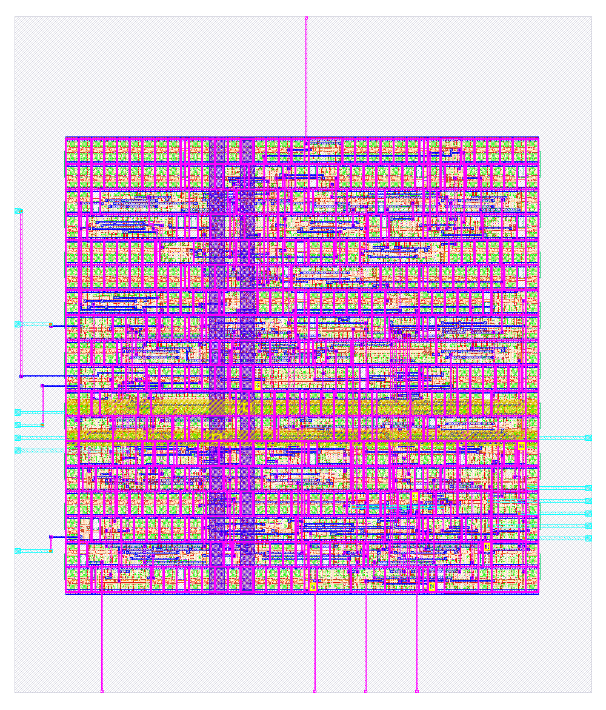

# Lab 05: Elevator to GDSII

You'll finish a four-floor elevator controller from a state table and take it all the way to a
`.gds` file: a real chip layout, DRC clean, LVS clean, with zero antenna violations, rendered as a
picture. You start from `src/elevator.sv`, a working three-state elevator that is a bad elevator
in two specific ways. Fixing those two things is the design half of the lab.

Time: about 4–5 hours.

Package: [`labs/lab-05-elevator/`](https://github.com/uoftasic/dd103/tree/main/labs/lab-05-elevator)

## Before you start

- [Lab 04](labs/lab-04-reading-the-receipt-overview.md) is complete, so `stat -liberty` is
  familiar.
- Read [Writing a state machine](guide/state-machine-is-a-table.md) and
  [From netlist to layout](guide/from-gates-to-geometry.md).
- Check your versions: `yosys -V` should say `Yosys 0.68` and `librelane --version` should say
  `LibreLane v3.1.0.dev3`.
- Each LibreLane run directory is about 65 MB. Budget a few hundred megabytes and delete old run
  tags.

Start in the package directory:

```bash
mod dd103
cd labs/lab-05-elevator
LIB=/foss/pdks/sky130A/libs.ref/sky130_fd_sc_hd/lib/sky130_fd_sc_hd__tt_025C_1v80.lib
```

## Part 1: Warm up on the vending machine

The vending machine from [Writing a state machine](guide/state-machine-is-a-table.md) ships in
`examples/vending.sv`.

1. Synthesize it:

   ```bash
   cd examples
   yosys -p "read_verilog -sv vending.sv; synth -top vending;
             dfflibmap -liberty $LIB; abc -liberty $LIB; opt_clean; stat -liberty $LIB"
   ```

   You should see `17  231.472 cells`, five `sky130_fd_sc_hd__dfrtp_1` and one
   `sky130_fd_sc_hd__dfstp_2`, and `65.41%` sequential. Six flip-flops from a three-bit state
   register.

2. Find the FSM passes in the log:

   ```bash
   yosys -p "read_verilog -sv vending.sv; synth -top vending" 2>&1 | grep -A3 'FSM_DETECT pass'
   yosys -p "read_verilog -sv vending.sv; synth -top vending" 2>&1 | grep -c 'transition:'
   yosys -p "read_verilog -sv vending.sv; synth -top vending" 2>&1 | grep -A9 'FSM_RECODE pass'
   ```

   You should see `Found FSM state register vending.state.`, a count of `14` transitions, and
   `mapping auto encoding to `one-hot` for this FSM.` followed by six one-hot codes. Pick two
   `transition:` lines from the full log and match them to rows of the table in the guide.

3. Turn the FSM pass off:

   ```bash
   yosys -p "read_verilog -sv vending.sv; synth -top vending -nofsm;
             dfflibmap -liberty $LIB; abc -liberty $LIB; opt_clean; stat -liberty $LIB"
   ```

   You should see `13  137.632 cells` and `54.55%` sequential.

4. Force binary encoding. `synth` has no encoding flag, so the coarse passes are spelled out.
   Note `opt -nodffe -nosdff` before `fsm`:

   ```bash
   yosys -p "read_verilog -sv vending.sv; hierarchy -top vending; proc;
             opt_expr; opt_clean; opt -nodffe -nosdff;
             fsm -encoding binary;
             opt; wreduce; peepopt; opt_clean; alumacc; share; opt;
             memory -nomap; opt_clean; techmap; opt -fast;
             dfflibmap -liberty $LIB; abc -liberty $LIB; opt_clean; stat -liberty $LIB"
   ```

   You should see three `sky130_fd_sc_hd__dfrtp_1`. Compare the area with the one-hot run in
   step 1.

5. Lint it:

   ```bash
   verilator --lint-only -Wall vending.sv
   ```

   You should see a verilation report and no warnings.

6. Break it on purpose. In `vending.sv`, delete the three default assignments at the top of the
   `always_comb` (`next = state;`, `dispense = 1'b0;`, `refund = 1'b0;`) and the
   `default: next = IDLE;` line. Then run `synth` and the linter again:

   ```bash
   yosys -p "read_verilog -sv vending.sv; synth -top vending" 2>&1 | grep -B1 ERROR
   verilator --lint-only -Wall vending.sv
   ```

   You should see `ERROR: Latch inferred for signal `\vending.\dispense' from always_comb process`
   from Yosys, and from Verilator a `CASEINCOMPLETE` warning with `(example pattern 0x6)` and
   `LATCH` warnings for `next`, `dispense` and `refund`. Put the file back:

   ```bash
   git checkout vending.sv
   cd ..
   ```

7. Optional: write `tb_vending.sv` yourself. Hold `rst_n` low for two cycles, pulse `nickel` or
   `dime` for one cycle at a time, and `$display` whenever `dispense` goes high. Run it with
   `iverilog -g2012 -o ../results/tb_vending.vvp tb_vending.sv vending.sv` and
   `vvp ../results/tb_vending.vvp` from `examples/`. Two dimes and four nickels should each
   dispense with `refund=0`, and a nickel then two dimes should dispense with `refund=1`.

You should be back in `labs/lab-05-elevator` with `vending.sv` unchanged.

## Part 2: The skeleton

The elevator is a Moore machine with three things to remember:

| Register | Width | What it holds |
|---|---|---|
| `state` | 3 bits | where in the cycle the machine is |
| `pending` | 4 bits | which floors have unanswered calls: the call queue |
| `dwell` | 4 bits | how many ticks the doors still have to stay open: the timer |

One clock tick is one step. In a real building `clk` would come from a divider so a step is about
half a second; here it is 20 ns, because that is what the testbench and `config.json` agree on.

This is the table you are implementing, one row per state:

| State | means | leaves when | `next` | `moving_up` | `moving_dn` | `door_open` |
|---|---|---|---|---|---|---|
| `IDLE` | parked, queue empty | `pending` is non-zero | `MOVING`, or `DOOR_OPEN` if already there | 0 | 0 | 0 |
| `MOVING` | travelling one floor per tick | `floor == target` | `DOOR_OPEN` | `target > floor` | `target < floor` | 0 |
| `DOOR_OPEN` | arrived; this call is answered | immediately | `DWELL` | 0 | 0 | 1 |
| `DWELL` | doors held open, counting down | `dwell == 0` | `DOOR_SHUT` | 0 | 0 | 1 |
| `DOOR_SHUT` | doors closing | immediately | `IDLE` | 0 | 0 | 0 |

`DOOR_SHUT` looks pointless, since it only goes to `IDLE`. It exists so that `door_open` falls one
tick before the machine is free to take the next call. Because a Moore output is a property of
the state, you get a clean extra state instead of a condition spread across two of them.

The next floor to serve is the lowest pending floor. That is a design decision, and Going further
argues with it.

1. Lint the skeleton, then simulate it:

   ```bash
   make lint
   make sim
   ```

You should see lint exit 0 on code you did not write, then six checks, three of which fail:

```
  PASS  T1 reset: floor 0, doors shut, display shows 1
T2  hold call[2] until the car arrives
  PASS  T2 held call to floor 2 is served
  PASS  T2 display shows 3 at floor 2
T3  tap call[3] for one cycle while the doors are open at floor 2
  FAIL  T3 one-cycle call to floor 3 is remembered (call queue)
T4  tap call[0] and time the doors
  PASS  T4 floor 0 reached
      doors stayed open for 1 ticks
  FAIL  T4 doors stay open at least 4 ticks (dwell timer)
T5  tap call[1] and call[3] in the same cycle
  PASS  T5 floor 1 served first
  FAIL  T5 floor 3 served afterwards

3 CHECK(S) FAILED
  -> not done yet. Fix the TODO blocks in src/elevator.sv.
make: *** [Makefile:32: sim] Error 1
```

The skeleton lints clean, synthesizes, and hardens to a valid chip. Every tool check passes, and
it still strands people on floor 3. The only thing that caught it was a test that describes what
the machine is for. Before you edit anything, keep a copy of the skeleton for Part 5:
`cp src/elevator.sv results/elevator_skeleton.sv`.

## Part 3: The call queue (TODO 1)

Right now the priority encoder reads `call` directly. If you press a button and let go while the
machine is busy, nobody comes.

1. Declare `logic [3:0] pending;` and reset it to `4'd0`.
2. Point the priority encoder at `pending` instead of `call`.
3. Add a signal `serve` that your `always_comb` raises for one tick in `DOOR_OPEN`.
4. Give `pending` exactly one assignment in the `always_ff`:

   ```systemverilog
   pending <= (pending | call) & ~(serve ? (4'd1 << floor) : 4'd0);
   ```

5. Run `make sim`.

You should see T3 and the second half of T5 pass.

Two things want to write `pending`: the buttons setting bits and the doors clearing one. Written as
two separate `if` statements in the same `always_ff`, the last one wins, and a press that lands on
the same tick as a service is lost. With one register and one assignment, both effects live in the
expression. Every status register in every chip is written this way.

## Part 4: A fifth state and a timer (TODO 2 and 3)

1. Add `DWELL` and `DOOR_SHUT` to the `typedef enum`.
2. Declare `logic [3:0] dwell;`.
3. In the `always_comb`, raise `dwell_load` in `DOOR_OPEN`, and `dwell_dec` in `DWELL` while
   `dwell != 0`.
4. Drive `dwell` from those two control lines in the `always_ff`:

   ```systemverilog
   if      (dwell_load) dwell <= DWELL_TICKS[3:0];
   else if (dwell_dec)  dwell <= dwell - 4'd1;
   ```

5. Delete the two `lint_off` / `lint_on` pragma lines around `DWELL_TICKS` at the top of the file,
   as the comment there says, and run `make lint`. If lint still passes, your timer really uses
   `DWELL_TICKS`.
6. Run `make sim`.

You should see:

```
T4  tap call[0] and time the doors
  PASS  T4 floor 0 reached
      doors stayed open for 6 ticks
  PASS  T4 doors stay open at least 4 ticks (dwell timer)
...
ALL CHECKS PASSED
```

It is six ticks, not four: one tick in `DOOR_OPEN` plus five in `DWELL` while the counter goes 4,
3, 2, 1, 0. Notice that no decision lives in the `always_ff`; it reads two wires the `always_comb`
already worked out. When the machine misbehaves, you have exactly one block to look at, the one
with the `case` in it.

> You may hit either of these errors, from tools that disagree with each other. Neither is a bug in
> your logic.
>
> Icarus rejects an enum assigned through a ternary:
>
> ```
> src/elevator.sv:89: error: This assignment requires an explicit cast.
> ```
>
> That is `next = (a == b) ? DOORS : MOVING;`. Verilator accepts it and `iverilog -g2012` does not.
> Write it as `if`/`else` and both are happy.
>
> If you write a comment that starts with the word `verilator`, Verilator reads it as a directive
> aimed at itself:
>
> ```
> %Error-BADVLTPRAGMA: solutions/elevator.sv:12:1: Unknown verilator comment:
>                      '/*verilator --lint-only -Wall -> exit 0*/'
> ```

## Part 5: Compare the receipts

1. Run `make synth` on your finished design:

   ```
   === elevator ===

          76  765.734 cells
           ...
          16  400.384   sky130_fd_sc_hd__dfrtp_1
           1   26.275   sky130_fd_sc_hd__dfstp_2
           ...
      Chip area for module '\elevator': 765.734400
        of which used for sequential elements: 426.659200 (55.72%)
   ```

2. Compare with the skeleton's numbers below. (If you want to reproduce them, run the Yosys
   command from the `synth` target in the `Makefile` on the copy you saved in Part 2.)

| | Skeleton (3 states) | Finished (5 states) |
|---|---|---|
| cells | 43 | 76 |
| area | 382.87 µm² | 765.73 µm² |
| flip-flops | 7 | 17 |
| sequential share | 46.08 % | 55.72 % |

You should see that eight extra flip-flops, four for `pending` and four for `dwell`, roughly
doubled the chip. Seventeen flops are 22 % of the cells and 55.72 % of the area. A `dfrtp_1` costs
25.02 µm² and a `nand2_1` costs 3.75, so state is the expensive part. That is why engineers argue
about minimizing states, and you now have your own number for it.

## Part 6: The RTL view

1. Run `make show`, then open `results/elevator_rtl.svg` in the browser or with `xdg-open`.
2. Search the SVG for your own signal names: `floor`, `target`, `pending`, `dwell`, `state`,
   `serve`, `any_pending`, `first_pending`, `door_open`, `moving_up`, `seg`.

You should see a wide strip, 6503 × 1566 pt for the finished design, with your names on the wires
and five register boxes for your five multi-bit state elements.

Do not run `show` on the gate netlist. Measured on this design, the gate-level diagram comes out
883 × 9018 pt, a vertical ribbon ten times taller than it is wide with 76 unlabelled boxes in it.
The readable gate view in [Lab 02](labs/lab-02-rtl-becomes-gates-overview.md) was a two-cell full
adder, which is about the size where `show` stops helping. Once the design is mapped to cells, you
look at it as a layout, which is Part 9.

## Part 7: RTL to GDSII

`config.json` is already written. Read it before you run it:

```json
{
  "DESIGN_NAME": "elevator",
  "VERILOG_FILES": ["dir::src/elevator.sv"],

  "PDK": "sky130A",
  "STD_CELL_LIBRARY": "sky130_fd_sc_hd",

  "CLOCK_PORT": "clk",
  "CLOCK_PERIOD": 20.0,

  "FP_CORE_UTIL": 35,
  "PL_TARGET_DENSITY_PCT": 45,

  "RUN_HEURISTIC_DIODE_INSERTION": true,
  "RUN_ANTENNA_REPAIR": true
}
```

Three things in it to notice:

- `PDK` and `STD_CELL_LIBRARY` are pinned. The image's default PDK is `ihp-sg13g2`, a different
  technology. Leave those two keys out and the flow runs, exits 0, and builds a chip out of
  `sg13g2_*` cells without any error.
- `VERILOG_FILES` names one file, not `dir::src/*.sv`. The glob is what upstream examples use, and
  here it would sweep up `tb_elevator.sv` and ask LibreLane to build silicon out of your
  testbench.
- There is no `DIE_AREA`. The floorplanner sizes the chip from `FP_CORE_UTIL`: you ask for 35 %
  core utilization and let it work out the rectangle.

1. Harden the design:

   ```bash
   make harden TAG=v1
   ```

   80 stages scroll past, and then:

   ```
   * Antenna
   Passed ✅

   * LVS
   Passed ✅

   * DRC
   Passed ✅

   [00:48:11] INFO     Saving views to '/work/runs/v1/final'…
   [00:48:11] INFO     Flow complete.
   Classic - Stage 80 - Report Manufacturability ━━━━━━━━━━━━━━━━━━━━ 80/80 0:00:57
   ```

   On a 6-core laptop with 7.5 GB of RAM this took 59 seconds of wall-clock time and peaked at
   525 MB. If yours takes noticeably longer, your design got bigger, not broken.

   A dozen `WARNING` lines follow. They are normal on a design with no SDC file and no power source
   location: `'PNR_SDC_FILE' is not defined`, `found 2 floating nets`,
   `LEF58_ENCLOSURE with no CUTCLASS is not supported`. None of them is a failure. The three ✅
   lines are the results that matter, and Part 8 checks them properly.

2. Confirm you built the chip you meant to:

   ```bash
   grep -m1 "Liberty frontend" runs/v1/06-yosys-synthesis/yosys-synthesis.log
   grep '"PDK"' runs/v1/resolved.json
   ```

You should see a liberty path under `/foss/pdks/sky130A/libs.ref/sky130_fd_sc_hd/lib/` and
`"PDK": "sky130A",`. If the path says `ihp-sg13g2`, your `PDK` key is not being read.

> Re-running with the same tag does not start over. LibreLane prints
> `INFO Using existing run at 'v1'` and appends stages 78, 79, 80… onto the finished run, which is
> confusing and doubles the disk use. Use a new tag every time: `make harden TAG=v2`. Don't reach
> for `--overwrite`; it crashes with a Python traceback when `runs/` does not exist yet.

## Part 8: The report card

1. Print the metrics:

   ```bash
   make metrics TAG=v1
   ```

   ```
   design__die__area                      4553.88
   design__core__area                     2499.9
   design__instance__utilization          0.550551
   timing__setup__ws                      11.664674889496723
   timing__hold__ws                       0.10763004681033471
   route__wirelength                      1989
   design__instance__count__stdcell       148
   antenna__violating__nets               0
   magic__drc_error__count                0
   klayout__drc_error__count              0
   design__lvs_error__count               0
   ```

   LibreLane exits 0 on runs with antenna violations in them. The exit code says the flow
   finished, not that the chip is good. The four zeros at the bottom are what "signoff clean"
   means.

2. Read the three sign-off reports directly:

   ```bash
   cat runs/v1/65-magic-drc/reports/drc.magic.rpt
   tail -5 runs/v1/71-netgen-lvs/reports/lvs.netgen.rpt
   cat runs/v1/47-openroad-checkantennas-1/reports/antenna_summary.rpt
   ```

   You should see `[INFO] COUNT: 0`, then `Final result: Circuits match uniquely.`, then an
   antenna table with a header and no rows.

3. Count the cell classes on the die:

   ```bash
   python3 -c "
   import json
   m = json.load(open('runs/v1/final/metrics.json'))
   for k, v in sorted(m.items()):
       if 'count__class' in k: print(k.split(':')[-1], v)
   print('design__instance__count', m['design__instance__count'])"
   grep -c sky130_fd_sc_hd runs/v1/final/nl/elevator.nl.v
   ```

   You should see `sequential_cell 17`, and the `grep -c` count equal to
   `design__instance__count`: every instance on the die is a SKY130 cell. A count of `0` would mean
   you hardened a different technology.

Three of the metrics need explaining.

`design__instance__count__stdcell` is 148, where Yosys said 76. The extra instances are real cells
the flow added after synthesis: a clock tree, hold-fix delay cells and antenna diodes. The logs
show what was inserted:

```
[INFO CTS-0018]     Created 3 clock buffers.
[INFO RSZ-0046] Found 11 endpoints with hold violations.
[INFO RSZ-0032] Inserted 14 hold buffers.
```

Those are eleven hold violations you never wrote. A hold violation is data arriving at a
flip-flop too early: the previous stage was so fast that the new value overtook the clock edge.
The fix is to slow the path down on purpose, which is why the layout contains 32 timing-repair
buffers costing 320.31 µm², and why `timing__hold__ws` came out at +0.108 ns: just positive,
because that is what the resizer aims for.

`timing__setup__ws` is +11.66 ns on a 20 ns clock. Your longest path takes about 8.3 ns, so this
elevator would run at roughly 120 MHz. It has 11.66 ns of headroom it isn't using, which you could
spend on more floors or a smarter scheduler.

The finished layout contains 481 physical cells. `metrics.json` counts 148 of them as standard-cell
instances, and only 118 of those compute anything:

| | count | what it is |
|---|---|---|
| `decap` | 265 | decoupling capacitors: local charge storage for the power rails |
| `fill` | 68 | nothing at all; filler so the rows are continuous |
| `tapvpwrvgnd` | 30 | well taps, tying the substrate to the rails |
| `dfrtp` / `dfstp` | 17 | your flip-flops |
| `clkdlybuf` / `dlygate` / `clkbuf` / `buf` | 37 | clock tree and hold repair |
| `diode` | 6 | antenna protection |
| everything else | 58 | your logic |

Decap, fill and taps are 363 of the 481. More than two thirds of the cells in your chip exist to
make the silicon manufacturable, not to make the elevator work. That is normal, and it is why an
area number from `stat` always underestimates the rectangle you end up paying for: 765.73 µm² of
cells landed in a 4553.88 µm² die.

## Part 9: The layout

The flow already rendered it, with no screenshot or X server needed.

1. Find the render, then open it in the noVNC desktop's browser or with `xdg-open`:

   ```bash
   ls -l runs/v1/final/render/elevator.png
   ```

   

2. Check the GDS:

   ```bash
   ls -l runs/v1/final/gds/elevator.gds
   ```

   ```
   -rw-r--r-- 1 designer designers 420588 ... runs/v1/final/gds/elevator.gds
   ```

You should see a rectangle 62.335 × 73.055 µm: rows of standard cells, magenta power straps
running vertically, a thicket of routing, and pins on the edges. Zoom in far enough and the
individual cells resolve. A human hair is 60–80 µm across, so your entire elevator controller is
narrower than one hair.

The 411 KB GDS file is the deliverable: the polygons, layer by layer, that a foundry would use to
make masks. Everything else in `final/` (`def/ lef/ lib/ nl/ sdc/ sdf/ spef/ spice/ vh/`) is the
paperwork that goes with it: the netlist someone else would simulate, the timing model someone
else would build on, the abstract view someone else would place next to their block.

## Finishing

You are done when this table is filled in from your own run:

| | Your number | Ours |
|---|---|---|
| `make sim` result | | `ALL CHECKS PASSED` |
| `verilator --lint-only -Wall` exit code | | 0 |
| cells / area from `make synth` | | 76 / 765.73 µm² |
| flip-flops, and their share of the area | | 17 / 55.72 % |
| die area | | 4553.88 µm² |
| die size in µm | | 62.335 × 73.055 |
| setup worst slack | | +11.66 ns |
| hold worst slack | | +0.108 ns |
| DRC (magic), DRC (klayout), LVS, antenna | | 0, 0, 0, 0 |
| wall-clock time for `make harden` | | 59 s |
| `runs/<tag>/final/gds/elevator.gds` exists | | 420,588 bytes |

Your numbers will not match ours exactly, and shouldn't: a different call-scheduling rule or one
extra state moves everything. These must match:

- all six checks pass
- the four error counts are zero
- setup and hold slack are both positive
- the synthesis log names `sky130_fd_sc_hd`, not `sg13g2`

If you are within about 20 % on cells and area, you built the same kind of thing we did. When all
six of your own checks pass, compare your design with the
[reference implementation](https://github.com/uoftasic/dd103/tree/main/labs/lab-05-elevator/solutions).
Keep two files from this lab: `elevator.sv` and `runs/<tag>/final/metrics.json`.

## Going further

- Delete a state. Merge `DOOR_SHUT` into `DWELL` and re-run `make synth`. You lose a state and
  gain a condition. Write down whether you expect the chip to shrink before you look.
- Argue with the scheduler. Lowest-pending-floor-first means somebody on floor 3 waits forever
  if floors 0 and 1 keep pressing. Real elevators use SCAN: keep going the way you were going,
  serve everything on the way, then reverse. Implement it, re-run `make sim` (the six checks still
  pass, since SCAN is a superset), and see what it costs in cells.
- Let the tool re-encode, or stop it. `synth -top elevator -nofsm` leaves your 3-bit state
  register alone instead of making it one-hot: 79 cells, 756.98 µm² and 15 flip-flops, against the
  default's 76 / 765.73 / 17. That is two fewer flops, three more gates, and 1.1 % smaller. On this
  design the binary-versus-one-hot trade is worth almost nothing, which is more useful to know than
  either side of the argument.
- Push the clock. Set `"CLOCK_PERIOD": 4.0` in `config.json` and harden again with a new tag.
  You have 11.66 ns of slack to spend; find out where it runs out, and read
  `runs/<tag>/56-openroad-stapostpnr/` for the path that failed first.
- Grow it. Add eight floors, a door-obstruction input, an overload sensor. The flow handled 76
  cells in 59 seconds, but detailed routing scales steeply, so keep it under a few thousand cells
  and re-check the wall-clock time as you go.
- Compare with someone else. Two people who both passed all six checks will have different cell
  counts, die sizes and slack. Find out which of your two decisions caused the biggest gap.

That is the end of DD103.
[DD104: Pre-Silicon Verification](https://uoftasic.com/dd104/) opens by putting your numbers next to
an 8-bit CPU's, a few thousand cells against your 76, and asking you to find the bugs in it.
